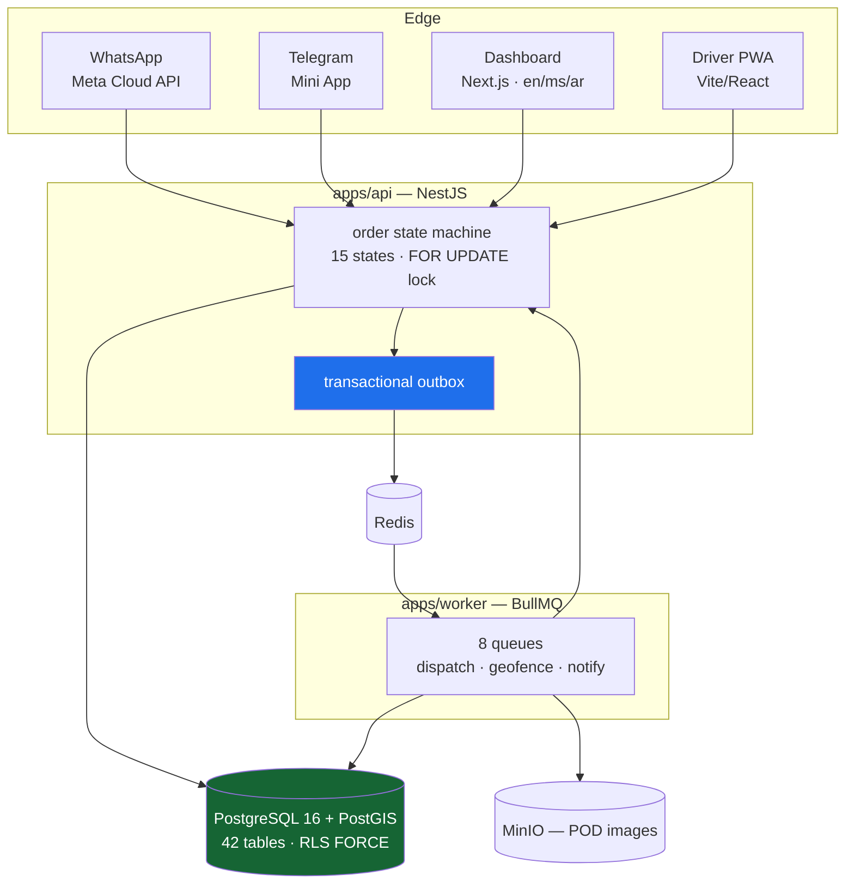

# QuickDrop

**Multi-tenant delivery and dispatch SaaS — WhatsApp ordering, AI pricing, own-fleet dispatch, live tracking.** A restaurant runs its own delivery instead of renting someone else's.


A customer orders on WhatsApp → an AI agent prices it against a deterministic server
engine → they pay (Billplz, MYR) → it auto-dispatches to the restaurant's own riders →
live tracking and proof of delivery → the customer stays in a shared Customer Brain.

> **Status, stated plainly:** built and deployed to a VPS behind Docker Compose and
> Caddy, with CI/CD. It has **never carried real customers** — the database holds seed
> fixtures only and the last request was July 2026. Read this as a systems-engineering
> artifact, not as a business with traction.

---

## Architecture



**6 apps** — `api` (NestJS), `worker` (BullMQ consumers + outbox poller + bots),
`dashboard` (Next.js), `driver` (Vite PWA), `miniapp` (Telegram), `e2e` (Playwright).

**11 packages** — `db` (Drizzle), `shared`, `telegram` (grammY), `whatsapp` (Meta Graph),
`billplz`, `ai` (LLM agent), `brain` (RFM), `spine` (event topics), `geo` (OSRM +
haversine), `storage` (S3 + sharp).

---

## Verified numbers

Measured 2026-08 on this tree.

| | |
|---|---|
| TypeScript | **44,205 LOC** across `apps/` + `packages/` |
| Tests | **571 cases in 82 files** |
| Database | **42 tables**, 24 SQL migrations, PostgreSQL 16 + PostGIS 3.6 |
| HTTP surface | **82 route handlers** |
| RLS enforcement | `FORCE ROW LEVEL SECURITY` across **10 migration files** |
| Build guards | 5, each failing the build |
| Commits | **111**, 2026-07-10 → 2026-07-26 |
| Toolchain | pnpm 11 workspaces + Turborepo 2.5, Node ≥22, TypeScript 5.8 strict |

TypeScript runs with `strict`, `noUncheckedIndexedAccess`, `exactOptionalPropertyTypes`
and `NodeNext`.

---

## Five guards that fail the build

Conventions that are only written in a style guide get violated. These are executable.

| guard | what it refuses to let through |
|---|---|
| `db:check-rls` | any tenant-scoped table without `ENABLE + FORCE ROW LEVEL SECURITY` and the canonical `tenant_isolation` policy |
| `db:check-money` · `check:money-code` | any money value that is not a `BIGINT` in the smallest currency unit — one checks the schema, the other blocks float arithmetic in code |
| `check:brain-seam` | any of the 36 Brain-A files calling dispatch directly, which would couple analytics to delivery |
| `check-secrets-hygiene` + gitleaks | secrets reaching a commit |
| ledger invariants | `DELETE`/`UPDATE` on the append-only ledger — revoked at the database grant level, not just in code |

---

## Tenant isolation, verified three ways

A forgotten `WHERE tenant_id = ?` in a delivery SaaS shows one restaurant another
restaurant's orders. So isolation is enforced twice and checked three times:

1. **Code level** — `withTenant()` sets a Postgres GUC for the transaction.
2. **Database level** — every business table carries `ENABLE + FORCE ROW LEVEL SECURITY`
   with one canonical `tenant_isolation` policy. `FORCE` matters: without it the table
   owner bypasses its own policy.
3. **Three independent checks** — a build-failing structural guard, a generated
   structural probe, and a generated **behavioural two-tenant zero-leak probe** that
   creates real rows under two tenants and asserts neither can observe the other.

The generalised pattern is published separately as
[**tenant-guard**](https://github.com/hani-amro/tenant-guard).

---

## Correctness work worth reading

**Exactly-once event emission** — `order.ready_for_dispatch` is emitted through a
write-once column claim (`state-machine.ts`): the outbox row is written only if a
conditional `UPDATE` actually hit a row. Verified by a chaos test that fires five
concurrent transitions and asserts exactly one emission. Without this, a double
dispatch means two riders and one paid order.

**Money is `BIGINT` only.** Smallest currency unit, everywhere, enforced by two guards.
Floating-point money is a bug you find in a settlement report months later.

**One state machine, 15 states, `FOR UPDATE` row lock.** Every transition goes through
`transition()`. Side effects go to a transactional outbox, so an order never changes
state without its consequences being durably recorded in the same transaction.

**Append-only ledger.** `DELETE` and `UPDATE` are revoked at the grant level. Code cannot
rewrite financial history even by mistake.

**Proof-of-delivery images are re-encoded** with sharp after magic-byte validation, 10 MB
cap — an uploaded image is never served back as-is.

**i18n** — dashboard in English, Malay (LTR) and Arabic (RTL), 394 keys, zero missing.

---

## Honest limitations

Most of these come from the project's own adversarial self-audit in
[`PROJECT_PROFILE.md`](PROJECT_PROFILE.md), which was written to find them.

- **It has never served a real customer.** Seed fixtures only; idle since 2026-07-24.
- **Never run as a single live full stack.** Components were exercised separately and in
  E2E, but the whole system has not run end-to-end under real load.
- **Zero tests on two frontends** — the Telegram Mini App (20 files) and the driver PWA
  (6 files). Front-end coverage is the weakest layer.
- **Not localized everywhere.** The Mini App and admin console are still Arabic-only and
  still assume Damascus/SYP defaults, while the product targets Malaysia. A real
  inconsistency, not a rounding error.
- **WhatsApp 24-hour session-window detection is missing**, so outbound notifications
  outside the window will fail silently until it is added.
- **The admin console has no 2FA.** Staff auth has TOTP; the admin console does not.
- **Single VPS, no HA.** Backups are a daily logical `pg_dump`, not `pgBackRest`. No
  tested restore-under-load.
- **Payments are Billplz/MYR only** (DuitNow, FPX). No other market is wired.

Earlier phases found and fixed real defects, including a double-charge, a revoke bypass
and a timestamp-poisoning bug. Those are in the history, not hidden from it.

---

## Run it

```bash
pnpm install
docker compose -f infra/compose/docker-compose.dev.yml up -d
pnpm db:migrate && pnpm db:seed-dev
pnpm dev

pnpm test                       # 571 cases
pnpm db:check-rls               # isolation guard
pnpm check:money-code           # money guard
```

Production compose, Caddyfile, backup and restore-test scripts are in [`infra/`](infra/).

---

## License

MIT — see [LICENSE](LICENSE).

*Git history is the original working history (111 commits, July 2026). Machine-specific
paths and the deployment host address were scrubbed before publishing; the governing
Arabic architecture specification and commercial planning documents are intentionally
not part of this repository.*
